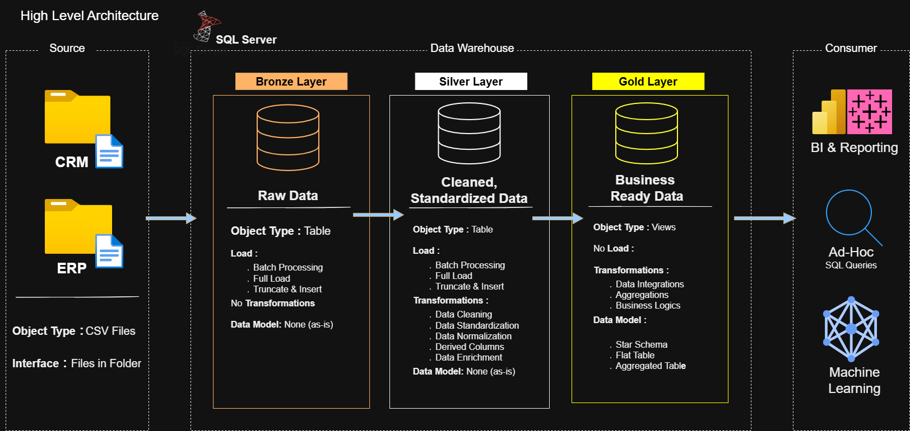

# SQL Server Data Warehouse
**CRM + ERP integration · Bronze/Silver/Gold architecture · Sales reporting model**

A portfolio implementation that loads six CSV source files into SQL Server, cleans and integrates the records, and exposes customer, product, and sales views for analysis.

## Business purpose

Sales reporting needs consistent customer and product information. This project separates raw ingestion from cleansing and reporting so that source issues and transformation logic can be inspected.

## Architecture

| Layer | Implementation | Purpose |
| --- | --- | --- |
| Bronze | Source-shaped tables and a bulk-load procedure | Load CRM and ERP CSV files |
| Silver | Cleansed tables and a transformation procedure | Standardize and integrate source records |
| Gold | Customer, product, and sales views | Expose a star-schema reporting model |

The Gold objects are **views**, not persisted fact and dimension tables. Product history is filtered to current records. Row-number-generated keys are not durable historical identifiers.

## Sources and outputs

[Source files](datasets/source/) include CRM customer, product, and sales records, plus ERP customer, location, and category records.

| Gold view | Reporting role |
| --- | --- |
| `gold.dim_customers` | Customer identity and attributes |
| `gold.dim_products` | Current products and categories |
| `gold.fact_sales` | Sales records with customer/product keys, dates, amount, quantity, and price |

Count distinct order numbers for order counts; a sales record is not automatically a whole order.

## Run locally

Use SQL Server and SSMS with permissions to create the project database and load files.

**The initialization script drops and recreates an existing database named `DataWarehouse`. Use an isolated practice environment and inspect the script before running it.**

1. Download or clone this repository.
2. Review [database initialization](scripts/init_database.sql), then run it only in the intended environment.
3. Select `DataWarehouse` as the database context for subsequent scripts.
4. Run [Bronze DDL](scripts/bronze/ddl_bronze.sql) and [Silver DDL](scripts/silver/ddl_silver.sql).
5. Edit all six file paths in [the Bronze procedure](scripts/bronze/proc_load_bronze.sql) to match the files under `datasets/source/`. The SQL Server service must be able to read them.
6. Run both procedure-definition scripts: [Bronze](scripts/bronze/proc_load_bronze.sql) and [Silver](scripts/silver/proc_load_silver.sql).
7. Execute `EXEC bronze.load_bronze;`, inspect messages and row counts, then execute `EXEC silver.load_silver;`.
8. Review [Silver quality checks](tests/quality_checks_silver.sql).
9. Create the [Gold views](scripts/gold/ddl_gold.sql), then review [Gold quality checks](tests/quality_checks_gold.sql).

The loaders use truncate-and-reload behavior. Inspect error messages and outputs; printed completion messages alone are not a validation record.

## Documentation and analysis

- [Architecture image](docs/DATA_ARCHITECTURE.drawio.png)
- [Data flow image](docs/DATA%20FLOW%20DIAGRAM.drawio.png)
- [Companion SQL exploration project](https://github.com/sharankumarsrathod12345/medallion-warehouse-eda-analytics)

## Scope and limitations

This is a portfolio warehouse with full reloads and current-state reporting. Incremental loading, historical dimension management, automated scheduling, and production performance benchmarks are not demonstrated here. Quality-check scripts are included; successful execution in a reader's environment must be verified separately.

[Repository license](LICENSE)

**Author:** Sharan Kumar Rathod
